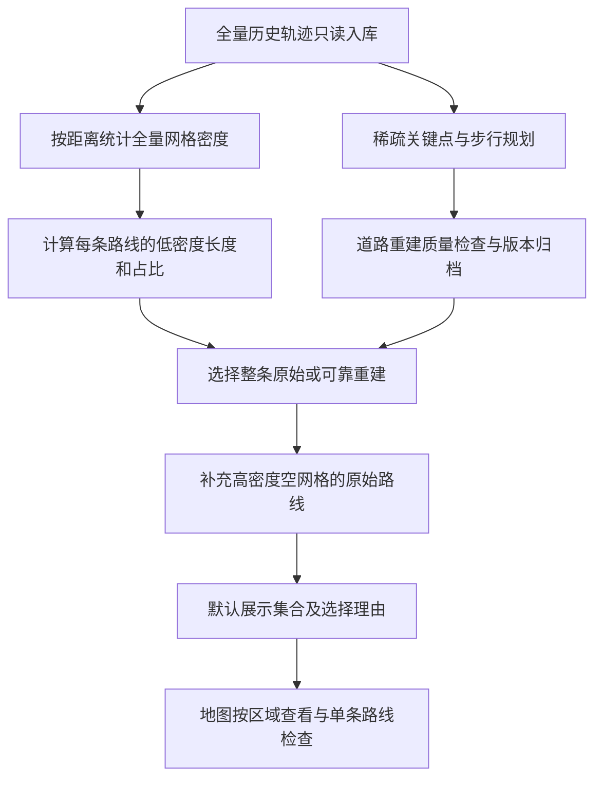

# 成都历史路线筛选主流程

## 目标

从大量历史轨迹中选择适合默认展示的路线，减少App地图杂乱和数据加载量。原始轨迹是覆盖证据，关键点定义支持按需重建，重建几何是可更新的表达。规划失败不等于现实无路，低密度地区不能因此丢失唯一覆盖。

本阶段以密度筛选与混合表达为主线，去重暂停扩展，仅保留可关闭的严格等价实验。不删除原始记录，不发布导航认证结果。

## 输入与三类数据

| 数据 | 保存内容 | 作用 |
|---|---|---|
| 原始轨迹 | 不可变原始分段、坐标及来源摘要 | 密度和覆盖依据、原始展示 |
| 路线定义及重建结果 | 有序起终点/关键点、版本、候选几何、质量与失败记录 | 重建、按需重新计算、对照 |
| 密度及展示决策 | 网格统计、低密度长度及占比、几何选择、保留理由 | 决定默认展示哪些路线及采用何种表达 |

前两类目前逻辑分开、同存city.sqlite3；第三类存在独立coverage/full.sqlite3。原始证据、定义与几何相互可追溯，并非只有一个点库。

## 当前实际流程

成都实际执行顺序是先完成全量重建尝试，再补充全量密度统计并复用已有结果。当前不是“先按密度过滤，再只对高密度路线规划”的自动队列；这可以作为后续节省规划工作的优化，但本轮没有实现或实测其收益。

### 1. 原始轨迹入库

保留原始数据和分段，建立路线编号、长度、范围、来源摘要。按批读取、可断点续跑。路线编号遵循入库顺序，非随机排序。

### 2. 统计全量区域密度

不能用前3000条代表全量密度；成都正式结果基于全部42130条。

- 5×5公里等面积格，每格25平方公里。
- 按距离作不超过20米的中点积分，按实际代表长度加权，避免GPS原始采样频率差异。
- 默认用于判断高低的是每格不同路线数：同一路线往返多次仍计一条。
- 累计长度密度另外保留，跑圈和往返正常增加，页面可以切换观察。
- 当前≤10条/格暂定低密度，>10条/格为高密度；密度一直基于全部原始，不随展示筛选变化。

10条是实验界限，不是经过准确率标注的最优值。网格描述数据覆盖，不证明区域偏远、道路合法、安全或当前开放，也不是人流量。

### 3. 准备可靠重建结果

从原始轨迹提取稀疏稳定关键点，使用本地GraphHopper步行规划，检查走廊偏离、长度、端点和顺序等质量，结果按版本保存。引擎返回不等于通过。review暂不当作可靠candidate。

路网越界、缺路、拓扑或权限问题可能使重建失败；不使用原始GPS或直线拼接来伪装成功，不覆盖原始轨迹。日后可以从定义重算几何，日常查看直接使用已存结果。

### 4. 决定路线是否默认展示、用哪种几何

先做基础质量门槛：统计长度为零、存在超过1000米而被排除的观测间隙的路线转待复核。该检查尚未覆盖完整速度、漂移和时间质量。

| 情况 | 当前处理 |
|---|---|
| 低密度长度≥全程20%，且累计≥500米 | 整条原始优先，即使有重建 |
| 全程不足500米的短路线 | 只有全程位于低密度格才触发上述优先 |
| 不满足低密度条件，已有可靠candidate重建几何 | 展示整条重建 |
| 不满足低密度条件，重建失败、尚未重建或待复核 | 暂不默认展示，进入下一步补空格候选 |
| 原始基础质量存疑 | 待复核，不自动进入展示 |

跨区域看全程经过的格，不按起点或行政区归属。路线3637约148.8公里，其中50.5公里、33.9%处于低密度格，采用整条原始。它有路网越界错误，不能因没有重建结果就删掉。

每条路线默认只选一种完整表达，不在高低密度边界拼接。跨区原始路线的城区部分也会显示，这是保留完整路线的结果。

### 5. 高密度空格补充

完成常规选择后，检查高密度格是否至少有一条已选路线的原始走廊经过。对空格从基础可用、尚未选中的原始路线中补充：

1. 按空格内长度贡献排序；评分每格至多5000米，平分按编号。
2. 每次检查尚未被覆盖格的新增长度，达到500米才选入；短路线须贡献全长。
3. 保留整条原始，更新空格集合，后续候选不为已补上的格重复入选。
4. 无满足条件的候选则保留空格，不伪造连接，不额外调用规划。

这是5公里级区域覆盖保护，不是每条道路的覆盖保护。以重建路线的原始走廊关联格作近似，不能证明重建几何精确经过格内全部道路。

### 6. 保存决策并展示

保存每条路线的几何类型、是否入选、低密度长度/占比和理由。未展示仅降低默认优先级，源记录与几何仍在库中。手动选择被隐藏路线可以检查，不表示自动加入默认集合。

密度页面保持以下模式：全部原始、覆盖代表原始、覆盖代表混合，以及默认高低密度表达。密度阈值在页面实时比较；调节不自动改写数据库中的默认阈值10决策。

## 成都结果与耗时

| 项目 | 实际结果或时间口径 |
|---|---|
| 原始数据 | 42130条，44233784个GPS点，约3.29GB输入 |
| 原始入库 | 实测约663秒，即11分钟 |
| 全量重建尝试 | 4912条candidate，1153条review，其余失败或预算内未完成 |
| 重建吞吐 | 连续25738条实测8113.55秒，约3.17条/秒，包含失败及结果写入 |
| 全量重建耗时推算 | 按该吞吐约3.7小时，非完整流程实测，不含路网准备和最后归档 |
| 全量密度 | 1305个有轨迹的5公里格，实测676.48秒 |
| 密度加初步筛选 | 实测731.14秒，约12分11秒，不含后续表达优化和页面导出 |
| 当前主流程默认集合（去重前） | 5370条：4900重建＋470原始，默认展示数减少约87.3% |
| 原始470条的构成 | 416条低密度优先、54条高密度空格补充 |
| 暂不默认展示 | 36759条降低优先级、1条基础观测待复核 |
| 空格保护 | 高密度空格118→0，仅为区域级检查 |

因此，已有原始库和重建结果时，重新统计及筛选是十几分钟级主要计算；从原始数据重新构建路线则是数小时级，还需另计路网准备和归档。不能把12分钟说成全流程耗时。

## 页面和产物入口

- [密度筛选与混合表达](http://localhost:8768/)：当前全量42130条，可调阈值、看贡献与理由。
- [原始与重建全量对照](http://localhost:8767/)：检查规划结果；左侧默认不加载，需要时开关启用。
- [20条样本及动线](http://localhost:8767/reconstruction.html)：人工查看原始与重建的行进过程。
- [密度细则](COVERAGE.md)：实现边界、运行顺序和空格补充规则。
- [严格去重实验](DEDUP.md)：附加实验，不作为主流程完成条件。

主要产物：outputs/chengdu-city/city.sqlite3为原始/定义/重建库，coverage/full.sqlite3为密度及默认决策库，coverage/full.report.json为密度结果报告；页面和缓存可重新生成。源码小报告保留于results/。

## 暂停扩展的去重实验

仅严格检查默认4900条重建，确认1条等价重复，21404由20980代表。页面“合并等价重建”可关闭；开启后当前显示4899重建＋470原始，共5369条。密度决策库仍为去重前5370条，去重关系独立保存，不改原始数据。

其余未合并不能理解为全部语义不同。暂不继续扩大去重范围或放宽阈值，以密度筛选流程作为本阶段交付主线。

## App接入边界

当前为本地实验闭环，没有修改已有线上API或生产数据。筛选减少默认路线数量，但不能代替视窗、缩放分级、缓存与选中后取详情的在线加载策略；不要让App一次下载全量内嵌页面数据。原始几何和重建几何应带明确来源及质量状态，均不等同于导航认证。

## v2最终展示覆盖筛选

上述5370条为密度基线，默认正式导出还会对其中4900条高密度重建执行compact/50%独有覆盖筛选。循环检查选中和落选路线直到稳定，环线与最后区域覆盖受保护，470条原始不参与；成都最终3275条（2805重建＋470原始），重建物理覆盖82.24%。这一步是有损展示选择，不证明语义等价。页面与CSV/NDJSON/GeoJSON/输出库使用同一策略。旧严格等价去重保持关闭。

关闭覆盖筛选：--overlap-mode off。覆盖优先：--overlap-mode coverage --overlap-fraction 0.1。切换页面参数不修改离线交付文件，正式参数调整需重跑delivery。输入源库只读，密度缓存通过源哈希和配置验证后可复用；重建引擎无需重跑。
