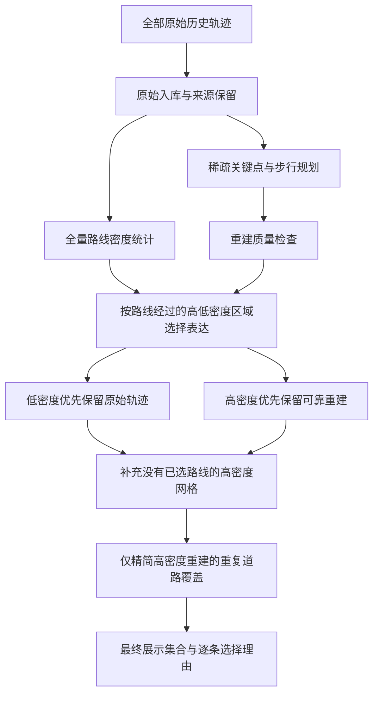

# 路线择优方案

整体方案：城市密集区域优先展示可靠重建，稀疏区域优先保留历史原始轨迹，减少默认展示路线数量，同时避免因路网不完整丢失区域覆盖。

## 一、原始路线

1. **原始路线太多太密**：同一地区大量轨迹叠加，很难识别可选路线，全部传输与绘制也增加开销。

   [图片]

2. **使用路线规划重绘路线**：城市中心重建效果较好，但偏远步道可能没有被路网收录；规划器可能绕路或失败。付费规划也不能消除缺路网问题。

   [图片]

3. **筛选**：城市里保留质量通过的重建，稀疏地区保留可用原始轨迹；高密度区域若没有任何已选路线，再补少量原始覆盖。

## 二、路线筛选

历史轨迹有价值，但原始记录数量不等于适合同时展示的路线数量。我们的目标是从全部证据里产生一个可解释的默认展示集合：每条入选路线有明确的来源、表达方式与选择理由；未入选的历史记录仍然保留。

方案不是把所有历史轨迹都修成道路路线，也不是直接把密集区域中的每条记录删除。

## 三、整体逻辑

密度按全部路线在5公里网格中的不同路线数量统计，同一路线反复经过一个格不会反复增加路线数。当前每格不超过10条为低密度，超过10条为高密度。一条路线至少20%的长度位于低密度区，且该部分不少于500米时，优先保留原始表达；不足500米的短路线按整条长度判断。

跨区域路线按沿途长度占比选择整条路线的表达，不在网格边界拼接原始与重建几何。常规筛选后，再给没有已选路线的高密度格补充少量原始路线。

最后只对入选的高密度重建计算独有物理道路覆盖，默认采用50%独有比例门槛，保护闭合或近闭合环线、复杂分段路线和最后区域覆盖。筛选会反复检查保留与落选路线，直到结果稳定；原始路线不参与这一环节。

## 四、各环节做了什么

以下以成都42130条历史路线为例。耗时来自已有实验记录；估算与实测分别注明，各环节计时范围不同。

| 环节 | 算法处理 | 大致耗时 | 路线变化 |
|---|---|---|---|
| 1. 原始入库 | 保存全部原始分段、路线顺序和来源，保证后续结果可追溯。 | 实测约11分钟。 | 42130条完整入库，此环节不减少路线。 |
| 2. 道路重建 | 从轨迹提取稀疏关键点，使用本地GraphHopper步行规划，再按偏差、长度和端点等门槛检查质量。 | 按已有连续批次约3.17条/秒的吞吐估算，全量约3.7小时；不含路网准备和最后归档。 | 得到4912条可靠候选，为城市密集区域提供更清晰的道路表达。 |
| 3. 密度筛选与补线 | 按5公里网格统计全量路线密度；低密度优先原始，高密度优先可靠重建，并为没有已选路线的高密度格补充原始覆盖。 | 全量密度统计及初步筛选实测约12分11秒，不含后续表达优化和页面导出。 | 42130条→5370条，其中4900条重建、470条原始；36760条不默认显示，高密度空格118个→0个。 |
| 4. 独有覆盖精简 | 对4900条高密度重建计算真实重合路段，按50%独有覆盖门槛继续精简，同时保护环线、复杂分段路线和区域覆盖；470条原始不参与。 | 本轮道路覆盖索引构建约15秒，默认单档筛选约0.5秒，不含文件读取与完整页面导出。 | 5370条→3275条，再减少2095条默认展示路线。 |

从原始数据开始，主要计算粗略合计约4小时，其中道路重建占绝大部分；这不是一次完整端到端计时。已有重建结果时，重新筛选和精简为分钟级。本轮复用已校验的密度缓存，包含覆盖索引、筛选、完整页面及CSV、GeoJSON等文件导出的实际耗时约4分12秒。

成都当前实验是先完成全量重建，再复用结果做密度筛选；上述流程不代表已经实现“只规划必要高密度路线”的自动批处理。

## 五、最终实现效果

默认展示从42130条降至3275条，减少约92.2%。

- 最终展示2805条重建＋470条原始；其余38855条不默认显示，但原始历史记录仍完整保留。
- 城市密集区域用可靠重建减少重复堆叠，稀疏区域保留原始轨迹，并通过区域补线避免高密度空格。其中54条原始路线用于区域补充；最终保留497条受保护的闭合或近闭合环线。
- 相对4900条高密度重建，最终保留约82.24%的规划几何物理覆盖；同时放弃部分独有覆盖，因此不是无损去重，也不表示路线在语义上完全相同。
- 页面与正式导出的路线清单采用同一规则，入选编号已核对一致。默认展示数量减少不代表服务器CPU、流量或响应耗时也下降同样比例。

以上结果用于解决默认展示过多、过密的问题；筛选参数仍需结合人工检查校准。区域有路线不代表所有道路都被保留，路线几何也不构成导航认证。
